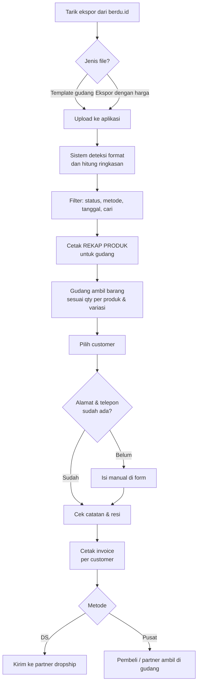

# Berdu Invoice & Gudang — Alur dan Struktur

Dokumen ini ditulis untuk dua sudut pandang:

- **Bagian A** — Admin marketplace / inventory (operasional harian).
- **Bagian B** — Full stack developer (arsitektur, data, dan rencana pengembangan).

---

## A. Sudut pandang admin marketplace / inventory

### A.1 Aktor

| Aktor | Peran |
|---|---|
| Admin marketplace | Menarik ekspor order dari berdu.id, mengecek data, membuat invoice |
| Admin gudang | Mengambil barang (picking) dan mengemas (packing) berdasarkan rekap |
| Reseller / dropship partner | Customer yang memesan atas nama tokonya, barang dikirim ke pembeli akhirnya |
| Kurir (Shopee/J&T) | Membawa paket, nomor resinya tercatat di kolom catatan |

### A.2 Dua jenis file dari berdu.id

| | Ekspor berdu.id | Template gudang |
|---|---|---|
| Dipakai untuk | Rekonsiliasi & invoice dengan harga | Picking & packing di gudang |
| Ada harga & diskon | Ya | Tidak |
| Ada alamat / telepon | Tidak di file ini | Tidak |
| Ada catatan & resi | Tidak di file ini | Ya, di kolom "Catatan dari pembeli" |
| Metode pengiriman | Tidak ada | Ada: `DIAMBIL DI GUDANG PUSAT` / `DIAMBIL DI GUDANG DROPSHIP` |
| Satu baris order | Baris dengan `Order Id`, item lanjutan tanpa `Order Id` | Baris dengan `Nomor`, item lanjutan tanpa `Nomor` |

Aplikasi mengenali format dari nama kolom header, jadi admin tidak perlu memilih format.

### A.3 Alur harian (end-to-end)



### A.4 Langkah detail

1. **Tarik ekspor.** Ambil file dari berdu.id untuk tanggal yang akan diproses. Satu file = satu tanggal kirim sebaiknya (lihat risiko di B.7).
2. **Upload.** Ringkasan langsung muncul: jumlah order, customer, baris produk, dan total (rupiah untuk ekspor, pcs untuk gudang).
3. **Cek pra-proses.**
   - Format yang terdeteksi tampil di bawah nama file.
   - Untuk ekspor: order dengan selisih total ditandai ⚠ (lihat A.5).
   - Untuk gudang: order yang punya resi dihitung di catatan customer.
4. **Filter.** Pakai status, metode pengiriman, rentang tanggal, atau kata kunci (nama, produk, SKU, resi). Semua ringkasan dan rekap ikut berubah sesuai filter.
5. **Rekap produk.** Tabel per produk dan variasi dengan total qty, dipisah antara gudang pusat dan dropship untuk format gudang. Cetak rekap ini sebagai daftar ambil barang.
6. **Invoice per customer.** Pilih customer, periksa alamat, telepon, dan catatan. Isi alamat dan telepon di form jika tidak ada di file. Isian manual disimpan di browser dan menang atas data file.
7. **Cetak.** A5 portrait, satu customer per halaman. "Cetak semua" mencetak seluruh hasil filter.
8. **Verifikasi resi.** Nomor resi di catatan (SPXID…, JY…, JZ…, SP…) dicocokkan dengan label kurir sebelum paket diserahkan.

### A.5 Penanganan pengecualian

| Kondisi | Yang terlihat di aplikasi | Tindakan admin |
|---|---|---|
| Total order tidak sama dengan subtotal − diskon | Peringatan ⚠ di daftar customer dan di preview | Cek di berdu.id apakah ada voucher atau biaya lain. Invoice tetap memakai Total dari file. |
| Alamat atau telepon kosong | "(alamat belum diisi)" di invoice | Isi di form sebelum cetak |
| Order tanpa resi | Catatan kosong untuk order itu | Cek di dashboard berdu.id / kurir |
| Nama customer ditulis beda (huruf atau spasi) | Digabung otomatis jadi satu customer | Tidak perlu tindakan |
| Customer punya order pusat dan dropship | Satu invoice dengan dua label metode | Lihat pertanyaan terbuka di B.8 |
| File gabungan dari beberapa tanggal | Nomor bisa bentrok antar tanggal | Upload per tanggal dulu (lihat B.7) |

### A.6 Yang tidak dilakukan aplikasi (sengaja)

- Tidak mengubah stok atau mengirim data ke berdu.id.
- Tidak menyimpan data pembeli di server. Semua proses terjadi di browser.
- Tidak mencetak label kurir. Label tetap dari Shopee/J&T atau sistem kurir.

---

## B. Sudut pandang full stack developer

### B.1 Stack dan deployment

- **Front end:** satu file `index.html`, HTML + CSS + vanilla JavaScript. Tanpa framework dan tanpa build step.
- **Library:** SheetJS (`xlsx@0.18.5`) dimuat dari jsdelivr hanya untuk membaca XLSX. CSV tetap jalan tanpa library ini.
- **Hosting:** static site di Vercel (root repo = root deploy, tanpa konfigurasi tambahan).
- **Backend:** tidak ada. Data order hidup di memori tab, isian manual di `localStorage`.

Struktur repo:

```
berdu-invoice/
├── index.html        # seluruh aplikasi (UI, parsing, render, print)
├── docs/
│   └── FLOW.md       # dokumen ini
└── README.md         # cara jalankan & deploy
```

### B.2 Pipeline data

```
File (CSV/XLSX)
  └─ fileToRows()            → string[][]          (CSV parser sendiri, XLSX via SheetJS)
       └─ parseOrders()      → deteksi header
            ├─ parseEkspor() → Order[]  (header = baris ber-Order Id)
            └─ parseGudang() → Order[]  (header = baris ber-Nomor)
                 └─ filtered()  → Order[]           (status, metode, tanggal, kata kunci)
                      └─ customers() → Customer[]   (dikelompokkan per nama ternormalisasi)
                           ├─ renderAll()       daftar customer + ringkasan
                           ├─ rekapHTML()       rekap produk per variasi
                           └─ invoiceHTML()     invoice per customer (+ effMeta)
```

### B.3 Model data

```ts
Order {
  id: string              // Order Id (ekspor) atau Nomor (gudang)
  buyer, reseller: string // Nama Depan; Nama Reseller (ekspor) atau = buyer (gudang)
  sent: Date | null       // Waktu Dikirim (ekspor) atau Waktu Dibuat (gudang)
  status, metode: string
  discount, total: number // hanya ekspor
  note: string            // catatan pembeli, sudah dibersihkan dari link & resi
  resi: string[]          // hasil ekstraksi regex RESI_RE
  addr, tel: string       // hanya jika kolom tersedia di file
  items: Item[]
  mismatch: boolean       // total file ≠ subtotal − diskon (ekspor)
}

Item {
  prod, variasi, sku: string
  qty, price, sub: number // price = 0 untuk gudang
  buyer, orderId, metode: string
}

Customer {                // hasil customers(), bukan disimpan
  key: string             // nama dinormalisasi: trim, spasi tunggal, lowercase
  name: string            // nama tampilan (kemunculan pertama)
  orders, items, metodes
  pcs, subtotal, discount, total
  addr, tel, note
  first: Date | null, invNo: string
}
```

### B.4 Aturan bisnis yang ada di kode

| Aturan | Lokasi | Catatan |
|---|---|---|
| Format ditentukan dari header | `parseOrders()` | Ekspor jika ada `Order Id`; gudang jika ada `Nomor`, `Nama Produk`, `Metode Pengiriman` |
| Order baru = baris dengan ID | `parseEkspor()`, `parseGudang()` | Baris lanjutan mewarisi order di atasnya |
| Resi | `RESI_RE`, `cleanNote()` | `SPXID…`, `JY…`/`JZ…` (≥8 digit), `SP…` (≥10 digit), angka ≥16 digit |
| Link Google Drive dibuang dari catatan | `cleanNote()` | Supaya catatan tetap bisa dibaca |
| Mismatch total | `parseEkspor()` | `subtotal − diskon ≠ total` |
| Invoice tanpa harga | `hidePrice()` | Otomatis untuk gudang; toggle hanya untuk ekspor |
| Label pengambilan | `pickupLabel()` | Dari metode yang ada di order customer; fallback ke `SENDER.pickup` |
| Nilai manual menang atas file | `effMeta()` | Disimpan per customer di `localStorage` |

### B.5 Keamanan dan privasi

- Semua teks dari file di-escape lewat `esc()` sebelum masuk ke HTML. Nama, catatan, dan produk dari file diperlakukan sebagai data, bukan markup.
- File tidak pernah diunggah ke server. Data pembeli hanya ada di memori tab dan `localStorage` browser.
- `localStorage` tidak dibagi antar perangkat atau antar admin. Ini disengaja untuk MVP, tetapi berarti isian alamat yang diketik di satu laptop tidak ada di laptop lain.
- Tidak ada autentikasi. Siapa pun yang membuka URL bisa memakai aplikasi. Jika URL Vercel dibagikan, data pembeli tetap aman selama tidak ada file yang diunggah ke sana, tetapi aplikasi itu sendiri publik.

### B.6 Pengujian

Saat ini pengujian dilakukan dengan Node dan stub DOM sederhana, mencakup:

- Jumlah order, item, dan pcs untuk kedua format.
- Ekstraksi resi dan pembersihan catatan.
- Invoice tanpa "Rp" untuk gudang.
- Total rekap sama dengan total pcs.
- Deteksi selisih total pada ekspor.

Rekomendasi: pindahkan fungsi parsing ke `lib/parse.js` (tanpa DOM) dan tambahkan `tests/parse.test.js` dengan fixture CSV yang sudah dianonimkan.

### B.7 Risiko teknis

| Risiko | Dampak | Mitigasi yang disarankan |
|---|---|---|
| `Nomor` hanya unik dalam satu ekspor | Jika dua file tanggal berbeda digabung, order bisa bentrok | Pakai kunci gabungan `tanggal + Nomor` saat multi-file |
| Nama customer dipakai sebagai kunci | Dua reseller dengan nama sama akan tergabung | Simpan ID reseller jika berdu.id menyediakannya |
| `localStorage` per browser | Alamat tidak tersinkron antar admin | Pindah ke backend + database bila admin lebih dari satu |
| SheetJS dari CDN | XLSX gagal dibaca jika CDN tidak bisa diakses | Vendor file `xlsx.full.min.js` ke repo |
| Parsing regex resi | Nomor non-resi yang kebetulan panjang ikut terbaca | Tambah validasi panjang dan prefix sesuai kurir |
| Print A5 | Ukuran kertas dan margin printer berbeda-beda | Uji dengan printer kantor sebelum produksi |

### B.8 Pertanyaan terbuka untuk admin

1. **Invoice per customer atau per metode?** Saat ini satu customer dengan order pusat dan dropship dapat satu invoice dengan dua label. Apakah lebih baik dipisah menjadi dua invoice?
2. **Sumber alamat dan telepon.** Apakah berdu.id bisa mengekspor alamat dan telepon pembeli? Jika ya, kirim contoh file-nya supaya kolomnya bisa dibaca otomatis.
3. **Multi-admin.** Apakah isian alamat perlu dibagi antar admin? Jika ya, kita perlu backend dan login.
4. **Ukuran invoice.** Apakah A5 sudah sesuai dengan kertas yang dipakai, atau perlu thermal 80 mm?

### B.9 Roadmap yang disarankan

| Fase | Isi |
|---|---|
| 1 (sekarang) | Preview dua format, invoice, rekap, cetak, deploy statis |
| 2 | Pisah modul parsing dari UI, tambah test, vendor SheetJS |
| 3 | Upload multi-file dengan kunci gabungan, invoice dipisah per metode (jika disetujui) |
| 4 | Backend ringan (mis. Vercel + database), login admin, simpan alamat dan riwayat cetak |
| 5 | Integrasi API berdu.id (jika tersedia) menggantikan upload manual |
